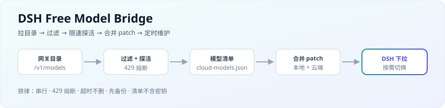

# DSH Free Model Bridge

[](LICENSE)
[](https://www.python.org/)
[](CONTRIBUTING.md)

**中文** | [English](README.en.md)

让 DSH（DeepSeek Harness）自动加载并持续更新**免费云端大模型**——解决"模型清单是静态的、上游下架留僵尸项、新模型不自动出现"的痛点。



> 前置：DSH 已部署（可用 [DSH Universal Installer](https://github.com/<owner>/dsh-universal-installer)），且有一个** OpenAI 兼容的代理网关**（如 FCC 等）暴露免费模型目录。

## 它做什么

DSH 接了免费模型后，provider patch 里的模型清单是手写静态 JSON。本工具让它**自己维护**：

1. **拉目录** —— 从网关的 `/v1/models` 拉当前可用模型
2. **过滤** —— 排除 embedding / rerank / 审核 / 视觉等非对话模型
3. **限速探活** —— 串行、间隔 ≥1.5s、每模型 1 次最小请求；**429 立即熔断**
4. **剔除失效 / 补入新模型** —— 404/410 才删，超时保留（宁留勿删）
5. **重生成 patch** —— 本地模型段 + 云端模型段合并成一个 DSH patch
6. **定时维护** —— systemd timer / cron / launchd / Windows 计划任务

## 安全铁律（这套逻辑的灵魂）

| 铁律 | 原因 |
|---|---|
| 绝不并发探测 | 免费层速率有限（常见 ~40 RPM），并发会瞬间打爆 |
| 429 立即熔断、不重试 | 撞限后重试只会更糟；本轮到此为止 |
| 超时不删、404 才删 | 慢模型超时正常，误删会丢可用模型 |
| 先备份再写 | 随时回滚 |
| 清单不含密钥 | key 走环境变量 / 网关本地配置，不进版本库 |

## 快速开始

### 1. 准备配置

```bash
cp config.example.json config.json
# 改 bridge.catalog_url / chat_url 指向你的网关
```

### 2. 预演：先看会过滤出哪些模型

```bash
python3 scripts/model_sync.py --config config.json --dry-run
```

### 3. 完整同步（拉清单 → 探活 → 写模型清单）

```bash
python3 scripts/model_sync.py --config config.json
```

### 4. 生成 DSH patch（本地 + 云端合并）

```bash
python3 scripts/gen_patch.py --config config.json --dry-run   # 预览
python3 scripts/gen_patch.py --config config.json             # 写入
```

### 5. 验证生效

```bash
dsh --profile web --dump-config    # 看真实生效的 provider 和模型
```

### 6.（可选）装定时同步

```bash
bash templates/install-schedule.sh systemd   # 或 cron / launchd / windows
```

## 三种部署方式

与 DSH Universal Installer 同构，`target.mode` 决定：

- **local**：网关和 DSH 都在本机，所有操作本地完成
- **ssh（局域网）**：在 NAS / 内网服务器上远程维护模型清单
- **ssh（远程）**：公网服务器，支持跳板机（`ssh_options: "-J ..."`）

见 [docs/DEPLOY-MODES.md](docs/DEPLOY-MODES.md)。

## 桌面版 DSH 能用吗？

**结论：模型清单逻辑是通用的，但注入方式不同——CLI/Web 版一键生效，官方桌面版需要手工合并一次。**

| DSH 形态 | 本工具适用性 |
|---|---|
| CLI / Web UI（`npx @deepseek-ai/dsh web`） | **完全支持**：`gen_patch.py` 生成的 patch 可用 `dsh web --patch <file>` 直接加载；`restart_command` 也能重启服务。 |
| 官方桌面版（Windows x64 / macOS Apple Silicon） | **部分支持**：桌面版内置 Harness，并沿用 `~/.dsh` 配置目录，但不提供 `--patch` 启动参数。做法是把生成的 patch 内容合并进 `~/.dsh/profiles/<profile>/cordis.patch.yml`（本工具输出的 JSON 本身也是合法 YAML），再重启桌面应用。 |
| 手机端 | 没有原生 DSH，只能通过浏览器访问远程 Web UI；本工具不提供 iOS/Android 客户端。 |

**桌面版使用要点**：

- 同步脚本是 Python 3.9+ 程序，Windows / macOS / Linux 都能跑；Windows 下建议把路径写成绝对路径。
- `local.models_command: "ollama list"` 要求本机装有 Ollama CLI；没有 Ollama 就留空，改用 `local.models` 静态列表，云端模型照常同步。
- `bridge.catalog_url` / `cloud.base_url` 必须是**运行脚本那台机器能访问到**的地址；网关和桌面版在同一台机器时 `127.0.0.1` 即可。
- 桌面版升级可能迁移 profile 数据，合并 patch 前先备份 `~/.dsh`。

**验证状态**：已在 Ubuntu + DSH Web/CLI 上完成真机端到端验证（过滤、探活、429 熔断、清单写回、双 provider patch、SSH 远程）。Windows / macOS 官方桌面版属于**配置路径兼容性分析，未在其桌面应用内实机跑过**；若你在桌面版上验证通过，欢迎提 issue 补充。

## 重要事实（避免踩坑）

- **免费层是速率限制，不是 credit 池**：多数免费层按 RPM 限流、不按 token 计费（以你所用网关的官方文档为准）。撞限就是 429，等一会儿即可。
- **网关目录是权威**：模型是否可用以探活结果为准，不要手写"应该能用"的清单。
- **fcc-merged 这类 patch 会整体替换 providers**：所以必须自己生成包含本地+云端两个 provider 的合并 patch，别用只写单一 provider 的工具。

## 文档

- [工作原理](docs/HOW-IT-WORKS.md)
- [三种部署方式](docs/DEPLOY-MODES.md)
- [配置参考](docs/CONFIGURATION.md)
- [排障速查](docs/TROUBLESHOOTING.md)

## 安全说明

- `config.json` 含端点信息，建议加入 `.gitignore`
- 任何 API Key 都不要写进本项目的文件；通过环境变量或网关自身配置注入
- 调试输出注意脱敏

## License

MIT。
